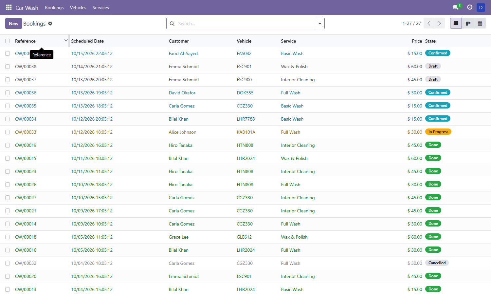
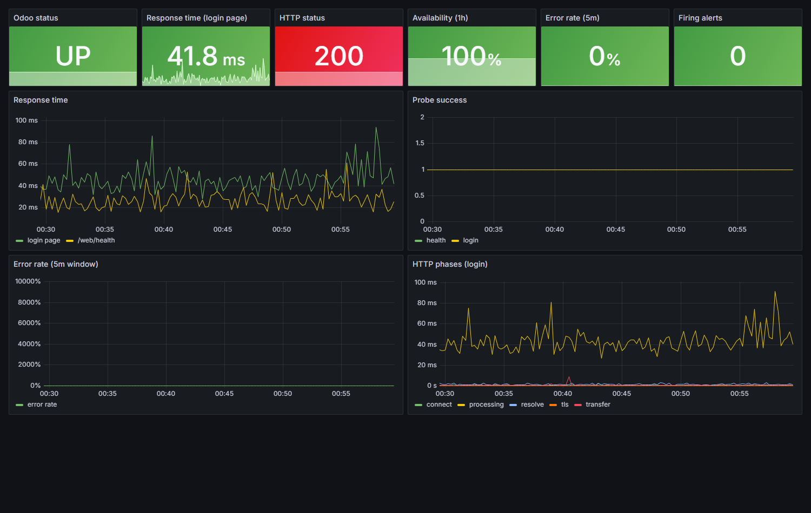
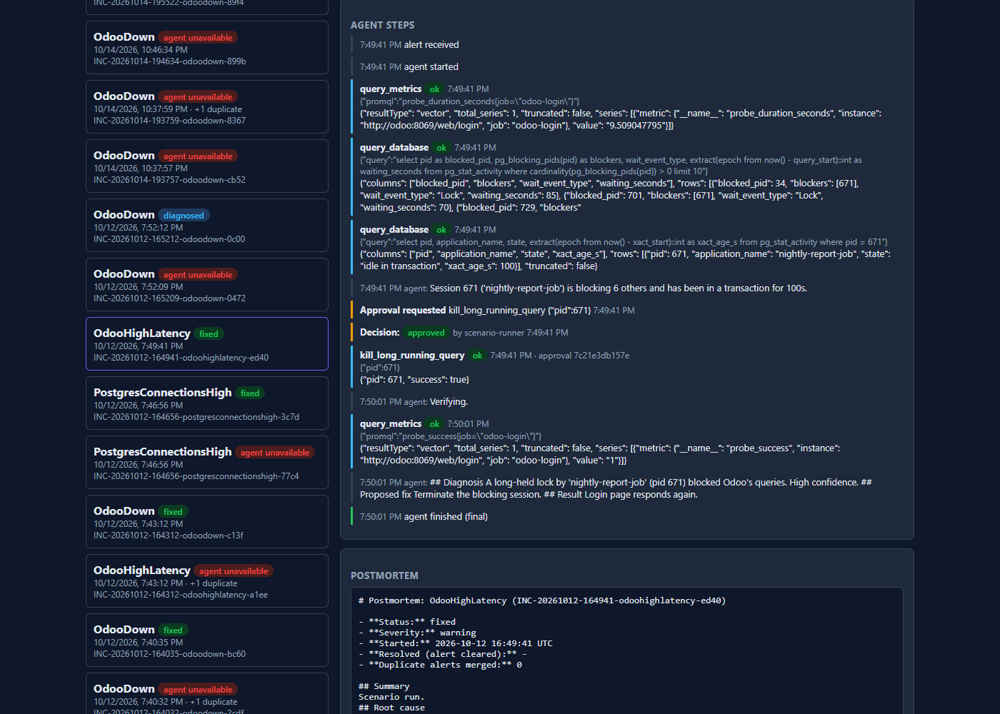
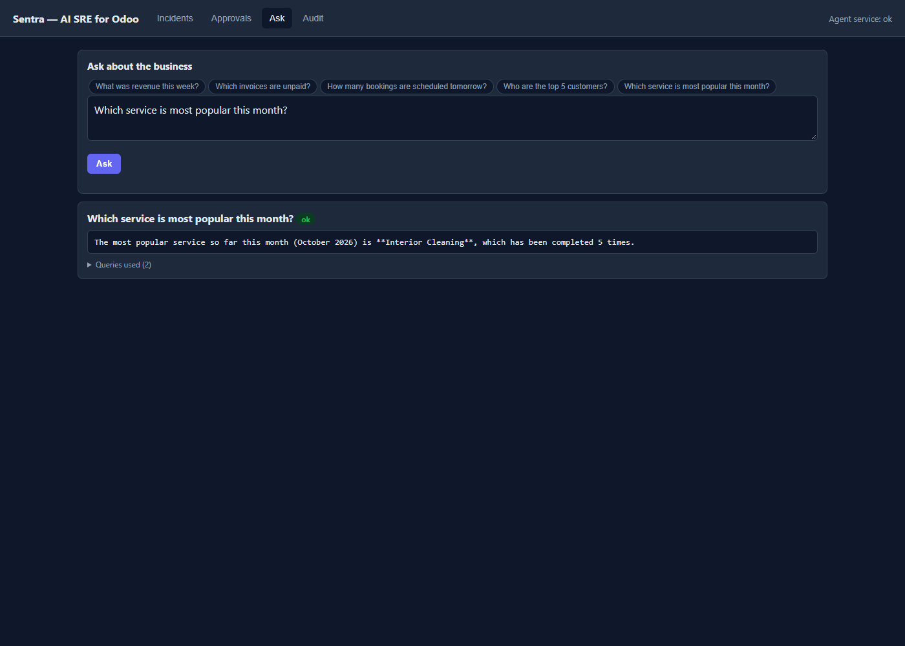
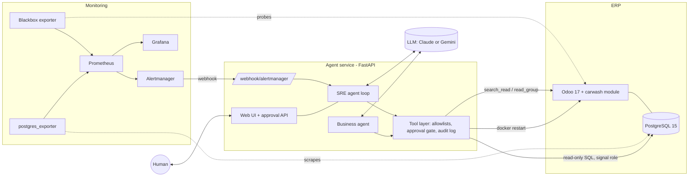

# Sentra

**An AI SRE for Odoo, demonstrated on a car wash business.**

Sentra runs a small ERP (Odoo with a custom `carwash` module), watches it with Prometheus and
Grafana, and puts two AI agents next to it:

- an **SRE agent** that receives alerts, investigates with read-only tools, proposes a fix, waits for
  a human to approve it, verifies the result and writes a postmortem;
- a **business agent** that answers questions like "which service is most popular this month?"
  from live Odoo data, read-only.

> No demo video. See the [screenshots](#screenshots) below, and [`docs/DEMO.md`](docs/DEMO.md) for a
> step-by-step walkthrough you can run yourself in about three minutes.

## The problem

Small teams run business-critical software with nobody on call. When Odoo goes down at night, someone
has to read logs, guess the cause and restart things by hand. Fully autonomous agents that touch
production are not acceptable either.

## The solution

Sentra keeps a human in the loop for every change and automates everything else:

| Stage | Who | How |
|-------|-----|-----|
| Detect | Prometheus + Alertmanager | 4 alert rules, webhook to the agent service |
| Investigate | SRE agent | read-only tools: container status, logs, PromQL, SQL (`pg_stat_*`), Odoo search |
| Decide | SRE agent | diagnosis with evidence and confidence, one proposed action |
| Approve | **Human** | Approve / Reject in the web UI; approval is single use and bound to the exact arguments |
| Act | Tool layer | 3 allowlisted actions: restart a service, clear Odoo caches, terminate one DB session |
| Verify + record | SRE agent | re-checks metrics, writes a Markdown postmortem and an append-only audit log |

## Screenshots

| Odoo `carwash` module | Grafana: Odoo health |
|---|---|
|  |  |

| Incident with approval flow | Business agent |
|---|---|
|  |  |

More: [incident list](docs/screenshots/ui-incidents.png),
[PostgreSQL dashboard](docs/screenshots/grafana-postgres.png),
[containers dashboard](docs/screenshots/grafana-containers.png).

## Architecture



Design details: [`SYSTEM_DESIGN.md`](SYSTEM_DESIGN.md) (scope, domain model, incident types) and
[`ARCHITECTURE.md`](ARCHITECTURE.md) (services, alert flow, tool layer, safety rules).

## Tech stack

Odoo 17 and PostgreSQL 15, Docker Compose, Prometheus, Alertmanager, Blackbox exporter,
postgres_exporter, cAdvisor, Grafana, Python 3.12 with FastAPI, a vanilla JS web UI, and an LLM
(Anthropic Claude, or any OpenAI-compatible endpoint such as Google Gemini's free tier).

## Setup

Requirements: Docker Desktop (or Docker + Compose), about 4 GB of free RAM.

```bash
cp .env.example .env          # then set the passwords and the LLM settings below
docker compose up -d --build
```

1. **Create the Odoo database and install the module** at http://localhost:8069 (database `sentra`,
   master password = `ODOO_ADMIN_PASSWD`), then install the *Car Wash* app. After a CLI
   install/upgrade, restart the `odoo` container.
2. **Seed demo data** (idempotent). Passwords and the agent API key are printed once; store them in
   `.env` as `SEED_*_PASSWORD` and `ODOO_AGENT_API_KEY`:

   ```bash
   docker compose cp scripts/seed.py odoo:/tmp/seed.py
   docker compose exec -T odoo sh -c 'odoo shell -c /tmp/odoo.conf -d sentra --no-http \
     --db_host "$HOST" --db_user "$USER" --db_password "$PASSWORD" < /tmp/seed.py'
   ```
3. **Create the least-privilege database roles:**

   ```bash
   sh scripts/create_monitor_role.sh       # postgres_exporter (pg_monitor only)
   sh scripts/create_agent_db_roles.sh     # sentra_readonly / sentra_signal + helper functions
   docker compose up -d                    # pick up the new passwords
   ```
4. **Choose the LLM** in `.env`:

   | Option | Settings |
   |--------|----------|
   | Anthropic (paid) | `LLM_PROVIDER=anthropic`, `ANTHROPIC_API_KEY=...`, `LLM_MODEL=claude-sonnet-5-5` |
   | Gemini (free tier) | `LLM_PROVIDER=openai_compat`, `LLM_API_KEY=<key from aistudio.google.com>`, `LLM_BASE_URL=https://generativelanguage.googleapis.com/v1beta/openai`, `LLM_MODEL=gemini-3.1-flash-lite` |

   Without any key the system still records incidents and writes postmortems with status
   `agent_unavailable`; only the reasoning step is missing.

| URL | What |
|-----|------|
| http://localhost:8069 | Odoo (`manager` / `staff` seeded users) |
| http://localhost:8000/ui | Sentra web UI (`UI_USERNAME` / `UI_PASSWORD`) |
| http://localhost:3000 | Grafana (`admin` / `GRAFANA_ADMIN_PASSWORD`), folder *Sentra* |
| http://localhost:9090, :9093 | Prometheus, Alertmanager (localhost only) |

## Try it

```bash
python scripts/failure_scenarios.py odoo_down     # stops Odoo, waits for the alert and the agent
```

Or by hand: `docker compose stop odoo`, wait about 90 seconds, open the web UI, read the diagnosis and
click **Approve** on the proposed `restart_service`.

## Safety model

- **Allowlists, not shells.** Every tool has a typed input schema; service names and RPC methods are
  checked against allowlists, and SQL must be a single `SELECT` with no comments, dollar quoting or
  forbidden keywords/functions, run as a read-only role that has no access to business table data.
- **Approval gate.** Action tools run only with a human-granted approval that is single use and bound
  to the exact arguments.
- **Least privilege.** Read-only DB role (`pg_monitor`, read-only transactions, 5 s timeout), a signal
  role that can only execute two `SECURITY DEFINER` helpers, and an Odoo API user that Odoo itself
  prevents from writing.
- **Tool output is data.** Logs, SQL rows and Odoo records are never treated as instructions.
- **Audit.** Every tool call and decision is appended to `audit/audit.jsonl` and shown in the UI.

## Tests and results

| Suite | How to run | Count |
|-------|-----------|-------|
| Odoo module (state machine, invoicing, access rights, constraints) | `odoo -d <scratch-db> -i carwash --test-enable --test-tags /carwash --stop-after-init` in the `odoo` container | 26 |
| Agent service (tools, safety rules, loop with a scripted LLM, approval API, UI, business agent, LLM adapter) | `pip install -r agents/requirements-dev.txt && pytest agents/tests` (needs `psycopg2`; or copy `agents/tests` into the `agents` container and run `python -m pytest tests`) | 103 |
| Business questions against SQL ground truth | `python tests/manual_business_truth.py` in the `agents` container | 5 + write denial |
| Failure scenarios on the live stack | `python scripts/failure_scenarios.py [scenario ...]` | 5 |

Failure scenario results with the real model (`gemini-3.1-flash-lite`, free tier); full detail in
[`incidents/FAILURE_SCENARIOS.md`](incidents/FAILURE_SCENARIOS.md):

| Scenario | Outcome | Time to recovery |
|----------|---------|------------------|
| Odoo container stopped | Pass: restart approved and verified | 106 s |
| PostgreSQL container stopped | Pass: restart approved and verified | 107 s |
| Long-held lock blocks Odoo | Pass: blocking session terminated | 126 s |
| Python error in the custom module | Pass: diagnosed, correctly escalated (no safe auto-fix) | 102 s (manual revert) |
| PostgreSQL connections nearly exhausted | **Fail**: correct diagnosis, escalated | not recovered |

Times are from the moment the failure was injected. They include the alert delay (about 70 to 140 s
before the alert fires, from the `for: 1m`/`2m` durations in the Prometheus rules plus scrape and
grouping intervals), so the agent's own work takes well under a minute.

## Known limitations

- **Connection exhaustion does not self-heal at scale.** The only DB action terminates one session
  per approval. With 80+ leaked sessions the agent runs out of steps after a handful of kills and
  escalates. A bulk "terminate idle-in-transaction sessions of application X" action with a single
  approval would fix it; it is not built.
- **Model quality.** Results above come from a small free-tier model. Diagnoses were correct in these
  scenarios, but this is five scripted failures, not a benchmark. Free-tier models also have tight
  rate limits and daily quotas; the adapter retries 429/503 and then reports the agent as unavailable.
- **Single node, single approver.** There is no multi-user approval workflow, notification channel
  (Slack, email) or role separation in the web UI beyond one Basic-auth login.
- **Container metrics on Docker Desktop.** cAdvisor cannot name containers there, so container
  metrics come from the agent service's `/metrics` endpoint.
- **Demo-grade deployment.** HTTP only, secrets in `.env`, Docker socket mounted into the agent
  service. Harden before anything real.

## Future improvements

- Bulk session cleanup action (see above) and a "dry run" preview in the approval dialog.
- Slack / email notifications with one-click approve links.
- Runbook retrieval so the agent can cite team-specific procedures.
- Evaluation harness that scores diagnoses across models (Claude vs Gemini vs local).
- More incident types: disk pressure, failed cron jobs, slow report queries.

## Repository layout

```
odoo/addons/carwash/   custom Odoo module (models, views, security, tests)
agents/app/            FastAPI service: loop, SRE + business agents, tools, UI
agents/tests/          103 offline tests + live helpers
monitoring/            Prometheus, Alertmanager, Blackbox, Grafana provisioning
scripts/               seed, DB roles, failure-scenario harness
incidents/             generated postmortems and scenario results
docs/                  demo script and screenshots
```
